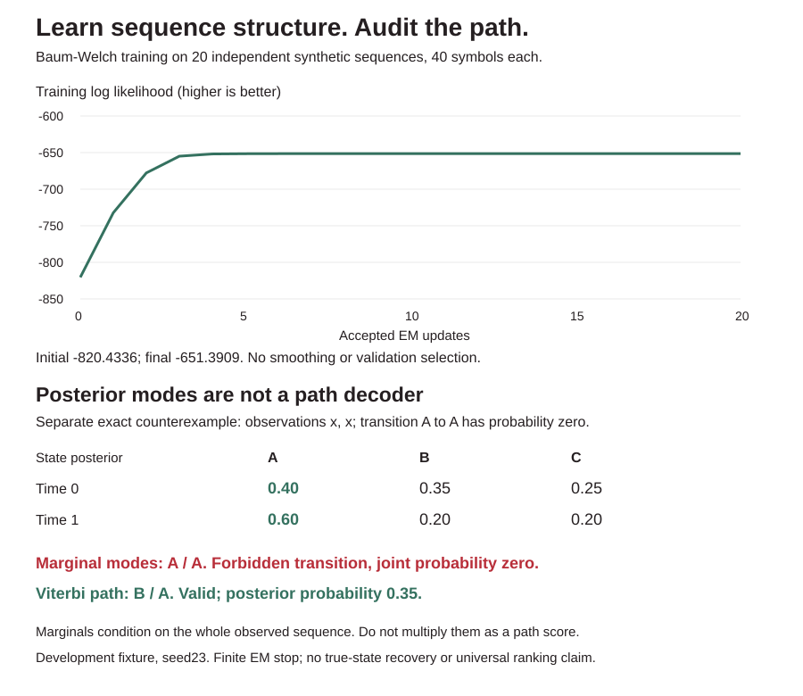

# ChainLab

Discrete hidden Markov models from scratch: log-space forward/backward,
state and adjacent-state posteriors, Viterbi paths and unsmoothed multi-sequence
Baum-Welch training. Dependency-free Python 3.10+, 34 tests, JSON CLI and an
offline, reproducible audit graphic. Standard HMM theory, not a new method.



## Learn sequences without hiding the controls

```sh
python -m chainlab demo
bash examples/demo.sh
```

Seed23 generates categorical observations from a two-regime HMM: 20 independent
training sequences and 12 test sequences, each length40. The supplied asymmetric
initialization is trained with a 30-update cap and total-likelihood improvement
tolerance1e-6. It stops after20 accepted updates, increasing training log
likelihood from -820.433625 to -651.390946. No smoothing, hyperparameter search,
initialization sweep, validation selection or test-based stop.

| Model | Test negative log likelihood per symbol (nats, lower is better) |
|---|---:|
| Supplied HMM initialization | 1.017638 |
| Training-only iid empirical symbol control | 0.985993 |
| Trained HMM | 0.775631 |
| Generating HMM reference, not learned | 0.771674 |

The iid control uses training symbol frequencies but no state persistence.
The generating model is an oracle reference, not an equally learned competitor
or a guaranteed finite-sample score winner. The fixture deliberately contains
persistent regimes. This is one inspected development fixture and seed, not an
external benchmark, proof that transitions caused the whole difference, true
state recovery, statistical significance, or a universal HMM ranking.

A separate one-state rare-symbol fixture has length256, finite log likelihood
about -3536.770703, while exponentiating that likelihood produces zero in
binary64. The API reports log scores, not an underflowed probability as evidence
of an impossible sequence. Truly zero-probability observations reject explicitly.

## A marginal state is not a valid path

The exact three-state counterexample in the demo has one observed symbol `x`,
initial probabilities `[0.4,0.35,0.25]`, and transition rows:
`A:[0,0.5,0.5]`, `B:[1,0,0]`, `C:[1,0,0]`. All states emit `x` with probability1.
For observations `[x,x]`:

| Time | P(A given all observations) | P(B) | P(C) |
|---|---:|---:|---:|
| 0 | 0.40 | 0.35 | 0.25 |
| 1 | 0.60 | 0.20 | 0.20 |

Per-position posterior modes give `A/A`, an impossible path because A-to-A is
forbidden. Viterbi returns valid `B/A`, with posterior probability0.35. State
marginals are not independent and must not be multiplied to get a path score.
`infer` and `viterbi` are deliberately separate APIs with different objectives.

## Infer, decode, fit, serialize

```python
from chainlab import infer, viterbi, fit

model = {
    "version": "chainlab_v1",
    "states": ["A", "B"],
    "symbols": ["x", "y"],
    "initial": [0.6, 0.4],
    "transition": [[0.7, 0.3], [0.2, 0.8]],
    "emission": [[0.8, 0.2], [0.1, 0.9]],
}
posterior = infer(model, ["x", "y", "x"])
path = viterbi(model, ["x", "y", "x"])
report = fit(model, [["x", "y", "x"], ["y", "y"]], iterations=10)
trained = report["model"]
```

`infer` returns sequence log likelihood, state posteriors for every time,
adjacent-state transition posteriors for every edge, and per-position posterior
modes. These condition on the **whole** sequence, including future symbols;
they are smoothed posteriors, not online filtering or forecasting.

`viterbi` returns the single maximum-joint-probability path, its joint log score,
observation log likelihood and posterior log score. Exact predecessor/final ties
keep the first state index at each local choice. This is not a promise of the
lexicographically first whole path among all tied paths.

Artifacts contain version, ordered unique state/symbol names, initial vector,
transition rows and categorical emission rows. `transition[i][j]` means next
state j given current state i. The initial vector precedes the first emission.
Every operation validates the artifact; JSON round trips preserve tested
inference. No executable code or dynamic loading. Inputs are not mutated.

```sh
python -m chainlab infer --input examples/request.json
python -m chainlab viterbi --input examples/request.json
python -m chainlab fit --input training-request.json --iterations 30 --tolerance 0.000001
# training-request.json is {"model": <initial artifact>, "sequences": [["x","y"],["y","x"]]}
```

All three commands support `--input -`. Invalid JSON, shapes, symbols,
probabilities or impossible sequences exit2 with stderr and no partial JSON.
The CLI demo checks a learned artifact and an explicit rejection gate.

## EM ownership and numerical contract

- Log-sum-exp forward/backward recurrences avoid multiplying tiny probabilities.
  Zero model probabilities remain log zero (`-Infinity` internally), never a
  secret epsilon. A zero-likelihood sequence raises an error.
- State and pair posterior rows are numerically normalized; the report includes
  their maximum pre-normalization mass error. Input model rows are **not**
  renormalized. They must sum to1 within1e-12.
- Baum-Welch sums expected starts, within-sequence transitions and emissions
  across independent sequences. Starts reset for each sequence. No fake
  transition is counted between separate sequences. The fixture has800
  observations but780 within-sequence transitions.
- Training is unsmoothed maximum likelihood, no pseudocount prior. A row with
  zero expected occupancy retains its old probabilities, with its index reported
  in the accepted history. All length-one sequences leave transition rows
  unchanged. Existing zero support cannot be resurrected; absent training symbols
  can lose emission support and become impossible at inference.
- Every proposed update is scored. A negative total log-likelihood change in
  [-1e-7,0) rejects the proposal, retains the previous model and records the
  rejected score. A larger decrease fails loudly. Accepted history is therefore
  nondecreasing, not a selectively plotted subset of bad accepted updates.
- Stop when an accepted total log-likelihood improvement is at most tolerance
  (absolute nats, not per symbol), or at the iteration cap. Tiny rejected
  numerical decreases have their own stop reason. No global or local-optimum
  certificate. Different initializations and symmetric state labels can give
  different or equivalent descriptions.

## Prefix filtering and unobserved-future forecasts

```python
from chainlab import filter_sequence, forecast

online = filter_sequence(model, ["x", "y", "x"])
future = forecast(model, ["x", "y"], horizon=3)
```

The `model` is the same validated `chainlab_v1` artifact used by infer/fit.
`filter_sequence` returns a state posterior for each prefix, prior-predictive
symbol probabilities **before** its symbol is observed, each observed symbol's
log predictive score, and prefix log likelihoods. At time0 the prediction uses
the initial state distribution; later steps transition the last filtered state.
It never uses later observations to update an earlier row. This is a batch
prefix audit, not a persistent streaming session or evidence that the supplied
model was trained without future-data leakage.

The difference from smoothing is exact on a two-state example: absorbing states
A/B, initial0.5/0.5, emissions A:[1,0], B:[0.5,0.5] for symbols x/y.

| State inference | Available observations | P(state A at time0) |
|---|---|---:|
| Filtering after first symbol | x | 2/3 |
| Full-sequence smoothing after both | x,y | 0 |

Using the smoothed row for an online decision at time0 would use future y.
The final filtered and final smoothed rows agree because they have the same
evidence at that time. This is a conditioning difference, not a performance
contest between algorithms.

Log posterior messages stay in log space between steps, so a path with a
raw-probability product below binary64 range can still become the only supported
state after a later observation. Printed probability entries can underflow to
zero even with a finite `observed_log_predictive`; the log scores are the
likelihood record, not `log` of the rounded probability table.

`forecast` accepts horizon1-32 and conditions on the whole supplied **past**
sequence. Horizon1 transitions once from the last conditioned state, then
predicts its emission. Each later step propagates states again without
assimilating any guessed observation. Returned state/symbol distributions are
**marginals**, not a joint future path and not independent across horizons.
In the absorbing-state example after x, each future marginal has P(y)=1/6,
but P(y,y)=1/12, not (1/6)^2. The implementation does not multiply forecast
marginals or feed their modes back as observed evidence.

```sh
python -m chainlab filter --input examples/request.json
python -m chainlab forecast --input examples/request.json --horizon 3
python -m chainlab online-demo
```

On the same trained seed23 development fixture, summed prefix predictive log
scores across12 independent test sequences (480 symbols) are -372.302842489947,
versus -372.30284248994707 from full forward likelihood: absolute difference
5.68e-14 on this run. Mean negative log predictive score is0.775630921854.
Every sequence resets to the model's initial distribution. This equality is an
implementation audit, not a new quality improvement or calibration result.
The demo forecasts five steps after only the first10 symbols of one test
sequence; no future symbols enter those distributions.

Filtering costs O(T*(N^2+N*M)) for alphabet size M and stores the prefix outputs.
Forecasts add O(H*(N^2+N*M)); no xi matrices or backward pass are needed. Results
are numerically normalized, with filtering mass-error diagnostics. Existing
model bounds, impossible-prefix rejection and no input mutation still apply.
No stateful streaming API, adaptive model update, calibrated forecast promise,
or proof that a caller's training protocol is leak-free.

## Bounds and limits

1-8 states, 1-16 symbols, unique names1-64 characters. Each inference sequence
has1-256 symbol names. Training accepts1-32 nonempty independent sequences,
maximum2048 observations total, iterations1-100, tolerance in[0,1]. Probability
entries are finite in[0,1]; booleans, unknown fields, bad shapes, duplicate names
and unknown symbols reject. All arithmetic is binary64; negligible posterior
mass can underflow to zero even though log likelihood remains finite.

Inference/decoding time O(T*N^2). Full transition posterior output and training
E-step storage use O(T*N^2), not a streaming low-memory implementation. EM
multiplies that work by sequences and accepted/proposed iterations. No Gaussian
emissions, continuous states, priors, missing observations, neural emissions,
variable state count, persistent streaming state, calibrated forecasting, beam search or state-label
alignment. No anomaly threshold, causal interpretation, calibration guarantee,
production deployment or speed claim. Caller owns sequence boundaries, feature
provenance, iid assumptions and train/test separation. No paid dependency,
network request or model download.

## Verification

```sh
python -m unittest discover -s tests -v
```

34 tests include exhaustive enumeration references for likelihood, every state
and adjacent-state marginal, and best-path scores; direct expected-count EM
updates; posterior consistency; one-symbol cases; exact tie behavior; rare-score
underflow; impossible observations; the invalid posterior-mode counterexample;
sequence-boundary resets; zero-occupancy retention; unsmoothed support loss;
monotonic accepted likelihood; simulated tiny/material decrease handling; label
permutation; input/schema bounds; no mutation; artifact/CLI round trips and
repeatable measured controls. Prefix filtering adds exhaustive-prefix and future-path
references, predictive-score equality, future-information separation, an underflow
rescue case, horizon indexing, dependent-marginal counterexample and CLI bounds.
Python3.10-3.13 CI plus an offline demo regenerates
the SVG and checks it against the committed output.

## Sources and credit

- [Rabiner (1989), A Tutorial on Hidden Markov Models and Selected Applications in Speech Recognition](https://www.cs.cmu.edu/~cga/behavior/rabiner1.pdf): forward/backward, Viterbi, marginal-mode warning and Baum-Welch.
- [Oxford HMM lecture slides](https://www.stats.ox.ac.uk/~caron/teaching/sb1b/slideshmm.pdf): filtering/prediction/smoothing conditioning and predict/update recursion.
- [University of Washington STAT534 HMM handout](https://sites.stat.washington.edu/mmp/courses/stat534/spring19/Handouts/h4-hmm.pdf): concise inference and expected-count reestimation equations.

Independent educational implementation of standard algorithms, not copied HMM
library code or new sequence-model theory. Synthetic data is labeled, not
attributed to real customers or an external evaluation. MIT license.


## v0.2: the evidence boundary is visible

The live prefix-evidence inspector keeps all original HMMs, training and scores fixed. Edit a displayed symbol, move the observed-prefix boundary and separate filtering from full-window smoothing, Viterbi paths from marginal modes, and prefix-only forecast marginals from joint future evidence. Both exact adverse examples remain available. The first three models display the first 12 observations of the original 40-symbol test sequence, explicitly labeled.

41 Python tests and four Node/actual-Chrome tests cover 114 position/symbol controls (including no-ops), 40 prefix witnesses, independent 70-digit tiny exhaustive path checks, separate browser scaling versus native log inference, invalidation/exports and responsive views. Installed reproduction imports eight modules and runs nine commands. Original state-recovery, causal, calibration and development-fixture limits remain. [EVIDENCE.md](EVIDENCE.md) gives numerical limits, derivations and reproduction.
